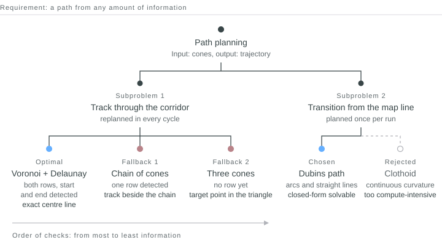

---
# Englische Fassung von index.md. Hier stehen nur die übersetzten Texte;
# Datum, Links, Reihenfolge und Entwurf kommen aus index.md.
titel: Path planning for an autonomous model car
kurz: A model car drives through a cone corridor that was detected from camera images
rolle: Path planning
tags: [Python, C++, ROS 2, Path planning, Geometry]
titelbild: ./korridor.en.png
titelbild_alt: Technical drawing of a cone corridor that branches off the map line at an angle, with the planned track, the transition from the map line and the vehicle outlines along the path
---

## Project

A model car at a scale of 1:10 autonomously follows a circuit that is painted on the floor
of the test environment. At an unknown point next to the track, a corridor is
marked out with cones. A cone directly on the driving lane marks its start.
The car is supposed to leave the lane there, follow the corridor to the end
and stop behind the last cone.

On board are an Intel NUC and an RGB-D front camera. The global position
comes from Aruco markers that are mounted in the room. The software is implemented in
ROS 2 and C++; prototypes were created in Python with Matplotlib.

*Fig. 01 — The map line runs straight through the alley of cones. The trigger cone stands less than 0.2 m from the line.*

Within the team, I was responsible for the path and trajectory planning. It receives the detected cones as coordinates in the fixed world coordinate system and delivers a
drivable trajectory of poses (x, y, θ) with the corresponding velocities.

The main difficulty was that the cones could only be detected from camera images. The camera's field of view and sensor noise were therefore strongly limiting factors.
The following could be assumed as given: the car does not fit between two
boundary cones.

## Approach

The requirement: a path must be created from any amount of information, from three
cones just as well as from two complete rows. The focus is
therefore on replanning and on fallbacks. The planner replans in every cycle,
and cones once seen remain known for the rest of the run. Neither classifiers nor costmap optimisation methods were used.

The trajectory consists of two parts: the track through the corridor and the
transition from the map line onto this track. For the track there is an optimal
solution and two fallbacks. Which branch runs depends on how many
cones have already been detected.

*Fig. 02 — Solution tree. On the left the track, from the optimal solution to the last fallback. On the right the transition.*

First, the planner divides the cones into two rows. Two cones belong to the
same row if they are at most 0.50 m apart. The threshold is
fixed so that the assignment cannot adjust itself.

### Optimal solution: Voronoi and Delaunay

If both rows, including the start and end of the corridor, have been detected, the planner computes
a Delaunay triangulation over all cones and from it the dual
Voronoi graph. Each of its edges lies equally far from the cones on both
sides. In this way it mathematically enforces the exact centre line as a graph structure. With a best-fit spline through the nodes, a drivable trajectory could thus be generated.

### Fallback 1: chain of cones

If only one row has been detected, the second side for the Voronoi graph is missing.
The planner then forms a chain along this row, starting from the trigger
cone. Each cone in the chain receives a driving vector. If at least
two cones of the opposite row are already known, it lies midway between two
smoothed splines through both rows, otherwise at a fixed distance of 45 cm.

### Fallback 2: only three cones visible

The camera, or rather the perception module, detects at least 3 cones before the planner is activated. In this case the planner does not yet deliver a
path, but a target point and a target orientation pointing in the direction of the expected cone corridor. While this driving manoeuvre is being executed, the planner receives new information about the cone corridor and can switch to fallback 1 or the optimal solution.

If this branch fails, the planner reports a planning error and brings the car safely to a stop.

## Transition and check

For the transition from the map line into the corridor, every point on the original line is a possible branch-off point. The curve leading there is a Dubins path: the shortest connection between two poses with a fixed minimum turning radius, made up only of circular arcs and
straight lines. It can be calculated in closed form. Brute-force methods such as RRT* were tested, but did not lead to useful results because the computation times were too long.

A clothoid would have been easier for the controller. Its curvature changes
continuously; with the Dubins path it jumps at every transition between arc and
straight line. The clothoid, however, has no closed-form solution and must be
calculated numerically. There was not enough computing capacity for that.

Finally, the planner checks the overall path: the vehicle rectangle against every
cone, for every pose. If a section collides, a local repair pushes
only this section away from the cone.

*Fig. 04 — Map line, transition and centre line as one path. The car follows the path and stops behind the last cone.*
