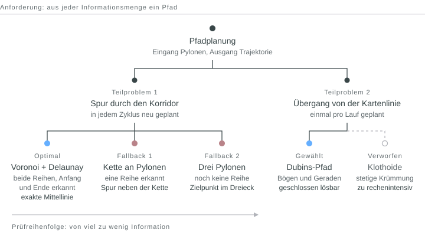

## Projekt

Ein Modellauto im Maßstab 1:10 folgt autonom einem Rundkurs, der auf den Boden
der Versuchsumgebung gemalt ist. An unbekannter Stelle neben der Strecke ist
mit Pylonen ein Korridor abgesteckt. Eine Pylone direkt auf der Fahrspur
markiert seinen Anfang. Das Auto soll dort die Spur verlassen, dem Korridor bis
zum Ende folgen und hinter der letzten Pylone anhalten.

An Bord sind eine Intel NUC und eine RGB-D-Frontkamera. Die globale Position
kommt über Aruco-Marker, die im Raum befestigt sind. Die Software läuft in
ROS 2 und C++, Prototypen entstanden in Python mit Matplotlib.

*Abb. 01 — Die Kartenlinie läuft gerade durch die Pylonengasse hindurch. Die Trigger-Pylone steht weniger als 0,2 m neben der Linie.*

Im Team war ich für die Pfad- bzw. Trajektorienplanung zuständig. Sie bekommt die erkannten Pylonen als Koordinaten im festen Weltkoordinatensystem und liefert eine
fahrbare Trajektorie aus Posen (x, y, θ) mit zugehöriger Geschwindigkeit.

Die Hauptschwierigkeit bestand darin, dass die Pylonen ausschließlich durch Kamerabilder erkannt werden konnten. Das Sichtfeld der Kamera und auch Sensorrauschen waren somit stark einschränkende Faktoren. 
Als gegeben konnte Folgendes angenommen werden: Zwischen zwei Randpylonen
passt das Auto nicht hindurch.

## Lösungsansatz

Die Anforderung: Mit jeder Informationsmenge muss ein Pfad entstehen, aus drei
Pylonen genauso wie aus zwei vollständigen Reihen. Der Schwerpunkt liegt
deshalb auf Replanning und auf Fallbacks. Der Planer plant in jedem Zyklus neu,
und einmal gesehene Pylonen bleiben für den Rest des Laufs bekannt. Sowohl auf Klassifikatoren als auch auf Costmap-Optimization-Methoden wurde verzichtet. 

Die Trajektorie besteht aus zwei Teilen: der Spur durch den Korridor und dem
Übergang von der Kartenlinie auf diese Spur. Für die Spur gibt es eine optimale
Lösung und zwei Fallbacks. Welcher Zweig rechnet, hängt davon ab, wie viele
Pylonen schon erkannt sind.

*Abb. 02 — Lösungsbaum. Links die Spur, von der optimalen Lösung bis zum letzten Fallback. Rechts der Übergang.*

Zuerst teilt der Planer die Pylonen in zwei Reihen. Zwei Pylonen gehören zur
selben Reihe, wenn sie höchstens 0,50 m auseinanderstehen. Die Schwelle ist
fest, damit sich die Zuordnung nicht selbst verstellen kann.

### Optimale Lösung: Voronoi und Delaunay

Sind beide Reihen mit Anfang und Ende des Korridors erkannt, rechnet der Planer
eine Delaunay-Triangulation über alle Pylonen und daraus den dualen
Voronoi-Graphen. Jede seiner Kanten liegt gleich weit von den Pylonen beider
Seiten entfernt. Damit erzwingt er mathematisch die exakte Mittellinie als Graphenstruktur. Per Best-Fit-Spline durch die Knoten konnte so eine fahrbare Trajektorie generiert werden. 

### Fallback 1: Kette an Pylonen

Ist nur eine Reihe erkannt, fehlt die zweite Seite für den Voronoi-Graphen.
Dann bildet der Planer von der Trigger-Pylone aus eine Kette entlang dieser
Reihe. Jede Pylone der Kette bekommt einen Fahrvektor. Sind schon mindestens
zwei Pylonen der Gegenreihe bekannt, liegt er in der Mitte zwischen zwei
geglätteten Splines durch beide Reihen, sonst in festen 45 cm Abstand.

### Fallback 2: nur drei Pylonen sichtbar

Die Kamera bzw. Perception hat mindestens 3 Pylonen detektiert, bevor der Planer aktiviert wird. In diesem Fall liefert der Planer noch keinen
Pfad, sondern einen Zielpunkt und eine Zielorientierung, die in Richtung des zu erwartenden Pylonenkorridors zeigt. Während dieses Fahrmanöver ausgeführt wird, erhält der Planer neue Informationen über den Pylonenkorridor und kann auf Fallback 1 oder die optimale Lösung wechseln.

Scheitert dieser Zweig, meldet der Planer einen Planungsfehler und bringt das Auto sicher zum Stehen.

## Übergang und Prüfung

Für den Übergang von der Kartenlinie in den Korridor kommt jeder Punkt der Ausgangslinie als Abzweigpunkt in Frage. Die Kurve dorthin ist ein Dubins-Pfad: die kürzeste Verbindung zweier Posen bei festem Mindestradius, nur aus Kreisbögen und
Geraden. Er lässt sich in geschlossener Form berechnen. Brute-Force-Methoden wie RRT* wurden getestet, haben aber aufgrund von zu langer Rechenzeit zu nicht sinnvollen Ergebnissen geführt. 

Eine Klothoide wäre für den Regler einfacher gewesen. Ihre Krümmung ändert
sich stetig, beim Dubins-Pfad springt sie an jedem Wechsel zwischen Bogen und
Gerade. Die Klothoide hat aber keine geschlossene Lösung und muss numerisch
berechnet werden. Dafür fehlte die Rechenkapazität.

Zum Schluss prüft der Planer den Gesamtpfad: das Fahrzeugrechteck gegen jede
Pylone, für jede Pose. Kollidiert ein Abschnitt, schiebt eine lokale Reparatur
nur diesen Abschnitt von der Pylone weg. 

*Abb. 04 — Kartenlinie, Übergang und Mittellinie als ein Pfad. Das Auto folgt dem Pfad und hält hinter der letzten Pylone.*
