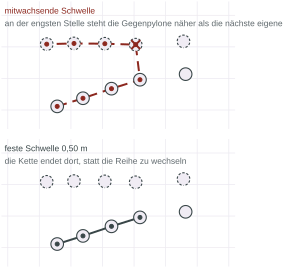
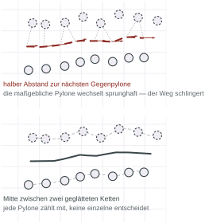
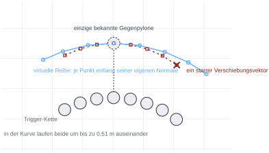
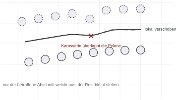

## Aufgabe
# Ausgangssituation
Ausgangssituation ist eine Aufgabe aus dem Bereich des autonomen Fahrens. Ein Modellauto soll autonom einem Straßenrundkurs folgen, welcher auf den Boden der Versuchsumgebung gemalt wurde. 
Irgendwo an der Seite des Rundkurses wurde mithilfe von Pylonen ein Korridor abgsteckt. Der Startpunkt des Korridors wurde durch eine Pylone signalisiert, welche direkt auf der Fahrspur des Autos platziert wurde. 
Das Modellauto ist im Maßstab 1:10 gebaut worden, war mit einer Intel-NUC ausgestattet und besaß sowohl eine RGB-D Front-Kamera, als auch eine globale Positionierung. Diese wurde durch im Raum befestigte Aruco-Marker realisiert.

# Problemstellung
Das Auto soll an geeigneter Stelle von der Fahrspur abweichen und dem Pylonenkorridor bis zum Ende folgen. die Pylonen werden so positioniert, dass sowohl links, als auch rechts der zu berechnenden Fahrspur Pylonen stehen. Hinter der letzten Pylone soll es autonom zum stehen kommen. 


*Abb. 01 — Die Kartenlinie läuft gerade durch die Pylonengasse hindurch. Die Trigger-Pylone steht weniger als 0,2 m neben der Linie.*

Der Auslöser ist rein geometrisch. Sobald eine Pylone näher als 0,2 m an der
Kartenlinie steht, gilt der Korridor als erkannt, und diese Pylone heißt
Trigger-Pylone. Das ist die einzige Bedingung.
Disclaimer: Es handelt sich hierbei um einen Ausschnitt eines größeren Projektes, welches in einem sechs-köpfigen Team umgesetzt wurde. Das hier beschriebene zeigt meinen anteil an dem größeren Projekt. Folglich ist die Problembeschreibung ein wenig gekürzt und entspricht nicht der vollständigen Projektbeschreibung. 
## Design-Entscheidungen 
Umgesetzt wurde das Projekt in ROS2 sowie in C++. Um schnelleres prototyping zu ermöglichen wurden Python-skripte und Matplotlib genutzt. 

Im Team haben wir uns dafür entschieden, dass die Pfadplanung als Input Koordinaten der Pylonen erhält, welche im festen Welt-Koordinatensystem gesendet werden. 
Output sollte eine fahrbare Trajektorie sowie zugehöriger Geschwindigkeit sein. Die fahrbare Trajektorie bestand aus einer Reihe x,y und theta Winkeln.  

## Grundlegende Einschränkungen

Die Pylonendetektion basierte vollständig auf der Auswertung von Kamera-Bildern. Dies bedeutet, dass neben starken Sensorrauschen in der Tiefensicht zusätzliche Schwierigkeiten, wie perspektivische Verdeckung einzelner Pylonen hinzukam. Zusätzlich konnte nicht ausgeschlossen werden, dass durch die Straßenführung einige Pylonen gar nicht im Sichtfeld der Kamera waren. 

Hieraus folgen zwei grundlegende Anforderungen an den Pfadplanungs-Algorithmus: 1. Der Algorithmus muss die Fähigkeit des Replannings besitzen und dabei bereits bestehende Informationen mit einbeziehen. 2. Für jede Anzahl an detektierter Pylonen muss eine fahrbare Trajektorie erzeugt werden können. 

Zuästzlich konnten von der Seite der Aufgabenstellung keine genauen Beschreibungen bezüglich der Korridorbreite sowie des Abstandes der Pylonen gegeben werden. Einzig der Hinweis, dass das Auto nicht zwischen zwei Randpylonen passt, wurde im laufe des Semesters als weitere Einschränkung gegeben. 
Lösungen bis zu diesem Zeitpunkt wurden also so formuliert, dass keine Heuristik/Annahme notwendig gewesen ist. 


*Abb. 02 — Jede Pylone trägt die Nummer des Frames, in dem sie zum ersten Mal erkannt wird. Die hintere Reihe ist früh vollständig, die vordere kommt verzögert und lückenhaft.*

Daraus folgt die Anforderung, an der alle frühen Ansätze gescheitert sind: der
Algorithmus muss aus **jeder** Zwischenstufe des Wissens einen fahrbaren Pfad
erzeugen. Aus einer Pylone, aus dreien, aus einer vollständigen Reihe und einer
einzelnen gegenüber, aus beiden Reihen. Ein Verfahren, das erst rechnet, wenn
das Bild vollständig ist, rechnet nie.

## Aufteilung des Problems: 
Das zu lösende Problem setzt sich aus zwei Teilproblemen zusammen: 1. Finde die Fahrspur durch den Pylonenkorridor. 2. Finde einen geeigneten Übergang von der bereits vorhandenen Straße auf die Fahrspur, also einen Übergang. Zunächst werden die Überlegungen zu der Pylonenfahspur betrachtet, anschließend die Übergangsansätze diskutiert. 

## 1.1. Ansatz: Klassifikator in Links und rechts der zu findenden Fahrspur: 

Die erste naive Idee: Da wir wissen, dass Pylonen links und rechts neben der zu findenden Fahrspur positioniert sind, können wir einen simplen Klassifikator, wie eine Support-vector-machine nutzen, deren Trennlinie genau der zu berechnenden Fahrspur entspricht.

Nach explorativem Testen wurde diese Idee sehr schnell wieder verworfen. Hintergrund ist einfach: Ein Klassifikator wird immer zwischen links und rechts trennen. Wenn aber das verhältnis zwischen linken Pylonen und rechten Pylonen nicht gut balanciert ist, dann kann die Klassifikation nicht zwingend eine gute Lösung finden. 

Erkenntnis: Pylonen sollen nicht in Klassen unterteilt werden, sondern ein topologischer Lösungsansatz soll her:

## 2. Ansatz: Cost-Map

Aus genau dieser Erkenntnis entsteht die Costmap. Jede Pylone bekommt eine Gauß-förmige Kostenverteilung. Steigender Abstand = sinkender Kostenwert. Minimum der Kostentopologie entspricht genau der Mittellinie zwischen den Pylonen. Dazu ein Optimierer über die Kosten, erst mit dynamischer Programmierung über laterale Versätze, später mit CasADi und IPOPT.

Hieraus hat sich ein einfaches Problem ergeben: Abstoßung allein kennt keinen Korridor. Der billigste Ort ist überall dort, wo keine Pylonen stehen, also außerhalb.  Damit ein Optimierer durch die Gasse fährt, braucht er eine anziehende Mittellinie als Gegengewicht. Diese Mittellinie ist aber genau das, was auszurechnen ist. Der Ansatz setzt also seine eigene Antwort voraus.
Eine alternative Idee war es zudem, anstatt der Gauß-Funktion, die Mexican-hat-Funktion als Kostenwert zu verwenden, da diese bei richtiger Justierung zu negativen Kostewerten kreisförmig um die Pylone möglich ist. Hier widerpsrechen wir aber der ersten Regel, dass keine Heuristiken o.ä. verwendet werden sollten. Da die justierung einen konkreten Radius um die Pylone benötigt, um der die Kostenfunktion ihr minimum haben soll, ist diese Lösung zu dem Zeitpunkt nicht geeignet. 


*Abb. 03 — Höhenlinien der reinen Abstoßungskosten. Der steilste Abstieg führt vom Korridor weg statt hindurch.*

## 3. Ansatz: Graphentheorie

Es ist dann eine Idee aufgekommen, die vor allem auch in der FEM und in der Computergraphik verwendet wird: Voronoi Graphen. Kurz erklärt: Jeder Punkt in der 2D-Ebene wird seiner dichtesten Pylone zugewiesen. Dies läuft jedoch zu bestimten Problemen, die bewusst genutzt werden. Punkte, die zu zwei Pylonen denseblen Abstand haben, können nicht zugewiesen werden. Selbes betrifft Punkte, die zu drei oder mehr pylonen denselben Abstand haben. Diese "nicht zuordnungspunkte" werden für das Bauen eine Graphen verwendet. Punkte. die genau zwischen 3 oder mehr Pylonen stehen, werden zu knoten. verbindet man alle Knoten, erhält man Kanten, die zu genau zwei Pylonen denselben Abstand halten. Die Knoten liegen per Definition genau zwischen den Pylonen und müssen nur noch per best fit zu einer Fahrtrajektorie zusammengerechnet werden. 

Obwohl dieser Ansatz gerade bei vollständigen Informationen über den Korridor hervorragend funktioniert, sehr gut mit fehlenden Zwischeninformationen umgehen kann und eine Fahrspur berechnet, die den maximalen Abstand zu den Pylonen erzwingt, sind zwei Bedingungen notwendig, die nicht immer als erfüllt angesehen werden können: 1. Es müssen auf beiden Seiten Pylonen sichtbar sein, 2. Sowohl der Anfang, als auch das Ende des Korridors müssen detektiert sein, um eine hinreichende Berechnung durchzuführen. Dies ist jedoch nicht immer gegeben.  

Daher wird dieser graphenbasierte Ansatz nur dann verwendet, wenn vollständige Informationen vorliegne. Wenn aber zu unvollständige informationen existieren, dann soll auf Fallbacks zurückgegriffen werden: 

## Ketten, die mitwachsen

Also lokal: von der Trigger-Pylone aus immer zur nächsten noch freien Pylone
springen, solange der Schritt nicht zu groß wird. Die Schwelle sollte sich dabei
selbst einstellen, als Vielfaches des bisherigen mittleren Schrittabstands.
Das schien robust gegen unterschiedlich dicht gesteckte Korridore.


*Abb. 06 — Oben kippt die Kette mit mitwachsender Schwelle beim vierten Glied auf die Gegenreihe. Unten endet sie mit fester Schwelle sauber an derselben Stelle.*

Genau darin lag der Fehler. Der mittlere Abstand ist ein Mittelwert über die
bisherigen Schritte, und jeder etwas längere Schritt hebt ihn an. Damit steigt
die Schwelle. Verengt sich der Korridor, steht die gegenüberliegende Pylone
irgendwann näher als die nächste eigene, und die inzwischen angehobene Schwelle
lässt den Sprung zu. Ab da läuft die Kette auf der falschen Reihe weiter.

In der Rechnung oben wuchs die Schwelle über drei Schritte von 0,52 m auf
0,61 m, während der Reihenabstand an der engsten Stelle auf 0,56 m sank. Das
reichte. Auf dem Auto sah man das als Trajektorien, die zwischen zwei
Planungszyklen von einer Korridorseite auf die andere sprangen.

Die Lösung ist unspektakulär: eine feste Schwelle. Zwei Pylonen gehören zur
selben Reihe, wenn sie höchstens 0,50 m auseinanderstehen, und die Gegenreihe
beginnt ab 0,60 m. Damit ist die Reihenzuordnung eine
Zusammenhangskomponenten-Zerlegung über eine feste Kantenlänge, und sie kann
sich nicht mehr selbst verstellen. Bricht die Kette an einer Lücke ab, ist das
ein ehrliches Ergebnis, mit dem ein anderer Zweig weiterarbeitet.

```cpp
// Zwei Pylonen gehören zur selben Reihe, wenn sie nah genug
// beieinander stehen. Die Schwelle ist fest und hängt nicht davon
// ab, was die Kette bisher gesehen hat.
RowClassification classifyRows(const std::vector<Cone>& cones,
                               const Cone& trigger,
                               double same_side_max_dist,
                               double cross_side_min_dist) {
    RowClassification result;
    if (cones.size() < 2) return result;

    const auto graph = neighborGraph(cones, same_side_max_dist);
    const auto components = connectedComponents(graph, cones.size());

    const int trigger_component =
        componentContaining(components, cones, trigger.id);
    if (trigger_component < 0) return result;

    // Normalfall: die Komponente der Trigger-Pylone ist die zu
    // verfolgende Reihe. Steht die Trigger-Pylone noch allein,
    // übernimmt die nächste Komponente mit mindestens zwei
    // Mitgliedern diese Rolle, und der Tausch wird gemeldet.
    int rear_component = trigger_component;
    if (components[trigger_component].size() < 2) {
        rear_component =
            nearestUsableComponent(components, cones, trigger_component);
        if (rear_component < 0) return result;
        result.trigger_row_isolated = true;
    }

    result.rear_line =
        fitLineTLS(positionsOf(cones, components[rear_component]));
    ...
}
```

## Ein Fächer aus Kandidaten

Mit einer verlässlichen Reihenzuordnung lag der nächste Schritt nahe: eine
Referenzlinie entlang der erkannten Reihe legen, im Frenet-Frame einen Fächer
aus Quintiken über laterale Zielversätze aufspannen, jeden Kandidaten gegen
Kollision und Krümmung prüfen und den billigsten nehmen. Kosten für
Wandabstand, Krümmung und Hysterese gegen Springen.

Das ist vollständig implementiert und lauffähig. Gefahren wird es nicht.

Der Grund ist, dass der Fächer ein Problem löst, das hier nicht besteht. Er
wählt aus vielen möglichen Spuren die beste aus. In einem Korridor von einem
Meter Breite bei 30 cm Fahrzeugbreite gibt es aber keine Auswahl. Es gibt eine
Spur, und die liegt in der Mitte. Der Fächer bringt sieben Kandidaten hervor,
von denen sechs zu nah an einer Wand liegen, und die Hysterese existiert nur,
um das Flackern zwischen den verbleibenden zu dämpfen. Dazu kommt, dass alle
Kandidaten an der Referenzlinie hängen. Verschiebt sich die Schätzung der
Wandlage, verschiebt sich der ganze Fächer mit.

Die Kosten und Gewichte waren am Ende Regler für ein Problem, das ich mir
selbst gebaut hatte. Der Code liegt noch im Repository, klar als ungenutzt
markiert.

## Die Breite aus beiden Reihen

Statt zu wählen, rechne ich die eine richtige Spur direkt aus. Jede Pylone der
verfolgten Reihe bekommt genau einen Fahrvektor: Position seitlich versetzt,
Orientierung aus dem Mittel der Nachbarrichtungen. Die Frage ist nur, woher der
seitliche Versatz kommt.

Der erste Versuch nahm den halben Abstand zur nächstgelegenen Pylone der
Gegenreihe. Das ist lokal korrekt und global unbrauchbar.


*Abb. 08 — Oben bestimmt jeweils die nächste einzelne Gegenpylone die Breite. Beim Wechsel der maßgeblichen Pylone springt der Versatz, und der Weg schlingert. Unten liegt die Spur in der Mitte zwischen zwei geglätteten Ketten.*

Die Reihen stehen auf Lücke, und keine Pylone sitzt exakt im Raster. Geht man
die hintere Reihe entlang, wechselt die nächstgelegene vordere Pylone
sprunghaft, und mit ihr der gemessene Abstand. Das Auto schlingerte auf gerader
Strecke durch den Korridor. In der Rechnung oben verlangt der obere Weg die
1,3-fache Lenkarbeit je gefahrenem Meter.

Die Abhilfe ist, keine einzelne Pylone entscheiden zu lassen. Beide Ketten
werden zu glatten Splines abgetastet, und die Spur ist der elementweise
Mittelpunkt. <mark>Jede Pylone geht mit ein, keine einzelne bestimmt das
Ergebnis.</mark>

Dazu kommt eine Klemmung, die mich mehrere Anläufe gekostet hat. Der Versatz
muss zu beiden Seiten einen Mindestabstand einhalten. Klemmt man nur gegen die
hintere Wand, schiebt eine enge Stelle den Fahrvektor über die Mitte hinaus
Richtung vordere Reihe, ohne zu prüfen, ob dort Platz ist. Das Fahrzeug
schleifte dann an der Gegenseite. Beide Schranken zusammen können sich
widersprechen, wenn der Korridor für beide Mindestabstände zu schmal ist. Dann
ist die Mitte der ehrlichste Kompromiss.

```cpp
// Lokale Korridorbreite: senkrechter Abstand des hinteren
// Spline-Punkts zur vorderen Polylinie. Eine Paarung über gleiche
// Indizes würde bei versetzten Reihen schräg messen und die Spur
// systematisch zu einer Wand ziehen.
const double corridor_width = std::min(widths[k], width_cap);

// Mindestabstand je Seite: das Größere aus geometrischer Schranke
// (Pylonenradius + Sicherheitsabstand + halbe Fahrzeugbreite) und
// dem gewünschten Wandabstand aus der Aufgabenstellung.
const double rear_limit  = sideLimit(rear_radius,  vehicle, wanted_gap);
const double front_limit = sideLimit(front_radius, vehicle, wanted_gap);

// Ziel ist die Mitte. Sie wird nur geklemmt, wenn das zulässige
// Band überhaupt existiert. Ist der Korridor für beide
// Mindestabstände zu schmal, bleibt die Mitte der fairste
// Kompromiss, statt den Vektor an eine Wand zu pressen.
double offset = 0.5 * corridor_width;
const double lower = rear_limit;
const double upper = corridor_width - front_limit;
if (lower <= upper) offset = std::clamp(offset, lower, upper);

const Vec2 position = rear_spline[k] + offset * perpendicular;
```

## Der Zielpunkt aus drei Pylonen

Ganz am Anfang, wenn nur zwei oder drei Pylonen stehen, gibt es noch keine
Reihe und damit keine Mittellinie. Für diesen Fall gibt es eine Notlösung, die
keinen Pfad liefert, sondern nur eine Richtung: die Trigger-Pylone, die
nächstgelegene weitere Pylone B und eine dritte Pylone C spannen ein Dreieck
auf, und das Ziel ist die Mitte zwischen B und C.

Der Prototyp wählte B und C rein nach Abstand zum Trigger. Das geht schief.


*Abb. 07 — Oben fallen B und C beide in Reihe A, der Zielpunkt liegt auf der Reihe statt im Tor. Unten stammt B aus der eigenen und C aus der Gegenreihe, der Zielpunkt liegt in der Lücke.*

Der Reihenabstand ist kleiner als die Korridorbreite, deshalb sind die beiden
nächstgelegenen Pylonen meist beide aus derselben Reihe. Der Zielpunkt landet
dann mitten auf der Reihe. Der Prototyp hat das sogar selbst gemeldet: die
Lücke zwischen B und C sei mit 0,20 m schmaler als das Fahrzeug. Er hat es
gemeldet und trotzdem dorthin gezielt.

Die gefahrene Fassung trennt vorher nach Reihen. B ist die nächste Pylone aus
derselben Reihe, C die nächste aus der gegenüberliegenden. Zusätzlich werden
nur Pylonen vor dem Trigger zugelassen, sonst gewinnt gelegentlich eine bereits
passierte Pylone und der Zielvektor zeigt rückwärts. Findet sich kein
Kandidat, scheitert der Zweig, statt ein falsches Ziel zu liefern.

## Wenn nur eine Reihe steht

Der häufigste Fall in der Praxis: eine Reihe ist als Reihe erkannt, von der
Gegenreihe ist noch nichts oder fast nichts bekannt. Dann gibt es keine Breite
zu messen, und der Versatz ist schlicht fest, 45 cm aus der Aufgabenstellung.


*Abb. 11 — Um jede Pylone ein Kreis mit dem Zielabstand. Der Fahrvektor liegt darauf, senkrecht zur Kettentangente. Die überlappenden Kreise ergeben zusammen die Fahrspur.*

Die Vorstellung dahinter hat mir beim Debuggen geholfen: um jede Pylone der
Reihe liegt ein Kreis mit diesem Radius, und der Fahrvektor liegt genau darauf.
Das Fahrzeug hält damit zu jeder einzelnen Pylone denselben Abstand,
unabhängig davon, ob zwei oder zwanzig bekannt sind. Der Fahrvektor der letzten
Kettenpylone markiert automatisch das Korridorende.

Die Fahrvektoren werden per kubischem Hermite verbunden, nicht per Dubins. Bei
eng beieinanderliegenden, ähnlich ausgerichteten Posen baucht Hermite sanft
aus, während die kürzeste Dubins-Kurve zu Schleifen neigt. Dafür garantiert
Hermite den Mindestradius nicht, was die Krümmungsprüfung danach auffängt.

## Wenn beide Reihen stehen

Sind beide Reihen mit genug Pylonen bekannt, gibt es einen genaueren Weg. Eine
Delaunay-Triangulation über alle Pylonen, dazu der duale Voronoi-Graph. Dessen
Kanten liegen per Definition gleich weit von den Pylonen beider Seiten
entfernt. Sie sind die Mittellinie, ohne dass irgendwo halbiert werden müsste.


*Abb. 10 — Oben der rohe Voronoi-Graph mit Verzweigungen an jedem Knoten. Unten dieselbe Struktur auf eine einzelne Kette beschnitten und geglättet.*

Der rohe Graph ist allerdings kein Pfad. Er verzweigt an jedem Knoten, und die
Randzellen laufen ins Unendliche. Der Weg zur Mittellinie führt über drei
Schritte: auf die konvexe Hülle der Pylonen beschneiden, dann jedem Knoten mit
Grad über zwei iterativ seine längste Kante nehmen, bis nur noch eine Kette
übrig ist, und schließlich unter allen Knotenpaaren mit Grad eins das Paar mit
der längsten Kette dazwischen wählen. Letzteres verhindert, dass ein kurzer
Seitenast gewinnt.

Dieser Zweig braucht mindestens vier Pylonen und erkennbare Struktur auf beiden
Seiten. Er ist der genaueste und der mit den meisten Voraussetzungen.

## Eine Reihe aus einer Pylone

Zwischen "eine Reihe bekannt" und "beide Reihen bekannt" liegt ein Fall, der
mich überrascht hat, weil er so häufig ist: die Trigger-Kette ist vollständig,
gegenüber steht genau eine einzige Pylone. Für eine Triangulation ist das zu
wenig, für einen festen Versatz von 45 cm ist es zu viel Information.

Die Lösung ist, sich eine Gegenreihe zu bauen. Die bekannte Kette wird kopiert
und um die gemessene Korridorbreite versetzt. Der Betrag dieser Breite ist die
Projektion des Abstands zur einzelnen Gegenpylone auf die Normale, nicht der
volle Abstand. Der längsseitige Anteil drückt keine Breite aus.


*Abb. 12 — Der Versatz je Kettenpunkt entlang seiner eigenen Normale folgt der Kurve. Ein einziger starrer Verschiebungsvektor läuft in der Kurve um bis zu 0,51 m davon.*

Der entscheidende Punkt war, den Versatz pro Kettenpunkt einzeln entlang seiner
lokalen Normale anzuwenden statt als einen starren Vektor für die ganze Kette.
In einer Kurve dreht sich die Korridor-Normale mit. Ein fester Vektor tut das
nicht und weicht mit wachsendem Abstand vom Anker immer stärker von einer
echten Parallelkurve ab. In der Rechnung oben sind das am Kettenende 0,51 m bei
0,90 m Korridorbreite.

Diese virtuelle Reihe ist reine Rechengrundlage. Sie geht als Voronoi-Eingabe
ein und darf auf keinen Fall in die Kollisionsprüfung gelangen. Geprüft wird
immer gegen die echten Pylonen.

## Einfädeln

Alle Zweige liefern eine Mittellinie im Korridor. Der Weg von der Kartenlinie
dorthin ist ein eigenes Problem, und es ist keine einzelne Kurve, sondern eine
Suche. Jeder Punkt der Spur kommt als Abzweigpunkt in Frage.


*Abb. 09 — Von jedem geprüften Abzweigpunkt eine Dubins-Kurve zum Korridoreintritt. Gekreuzt die Übergänge, die die Karosserie in eine Pylone führen, gepunktet die als Schleife verworfenen. Durchgezogen der gewählte.*

In der Rechnung oben wurden 20 Abzweigpunkte geprüft. Neun Kandidaten wurden
als Schleife verworfen, weil ihr kumulierter Drehwinkel über 3,9 rad lag. Das
ist eine harte Grenze unabhängig von der Länge, denn ein enger Vollkreis ist
kurz genug, um nach Länge zu gewinnen. Von den verbleibenden elf war der
kürzeste kollisionsfreie 1,15 m lang.

Die Suche läuft in drei Stufen, alle in geschlossener Form, ohne Iteration und
ohne Zufall. Zuerst ein Biarc aus zwei tangentenstetigen Kreisbögen mit
möglichst großem Radius. Wenn dessen Bögen den Mindestradius unterschreiten,
Dubins über alle Worttypen und einen Radienfächer. Und wenn auch das nichts
liefert, als letzte Stufe ein abgesenkter Radius mit hart gedeckelter Länge.
Nur diese letzte Stufe unterschreitet den Mindestradius überhaupt.

Ein Detail, das zwei Tage gekostet hat: der Suchraum muss an der ersten Pylone
abgeschnitten werden, die das geradeaus weiterfahrende Fahrzeug treffen würde.
Die Trigger-Pylone steht per Definition nah an der Spur. Ohne diesen Schnitt
liegt der günstigste Abzweigpunkt hinter ihr, und das Auto lenkt erst nach der
Pylone ein.

## Reparieren statt neu planen

Am Ende steht die Kollisionsprüfung des Gesamtpfads: Fahrzeugrechteck gegen
Pylonenkreise, für jede Pose. Schlägt sie an, wäre eine vollständige Neuplanung
die naheliegende Antwort. Sie ist auch die falsche, denn der Pfad ist fast
überall richtig.


*Abb. 14 — Eine Pylone der Gegenreihe steht in den Korridor hinein. Nur der betroffene Abschnitt weicht aus, der Rest des Wegs bleibt unverändert.*

Stattdessen arbeitet eine lokale Reparatur fensterweise: kollidierende
Abschnitte werden von der Pylone weggeschoben, rein krümmungsdefekte
Abschnitte geglättet, in höchstens sechs Durchläufen. In der Rechnung oben
waren vorher neun Punkte beanstandet und nachher keiner.

Das hat eine klare Grenze, die ich messen konnte. Steht die störende Pylone bis
zu 0,18 m in den Korridor hinein, repariert das Verfahren vollständig. Ab
0,22 m bleiben Beanstandungen übrig, und der Zyklus scheitert ehrlich, statt
einen unfahrbaren Pfad auszugeben.

## Was über Zyklen hinweg bleibt

Die Pipeline plant jeden Zyklus komplett neu. Pylonen bewegen sich nicht,
derselbe Pylonensatz führt deterministisch zum selben Ergebnis, also gibt es
keinen Grund, einen Plan zu merken. Drei Ausnahmen gibt es trotzdem, und jede
davon geht auf einen konkreten Fehler zurück.


*Abb. 15 — Die fünf Planungszweige in ihrer Prüfreihenfolge, von der Reihenzuordnung bis zur Kollisionsprüfung des Gesamtpfads.*

Das Pylonen-Gedächtnis war die erste. Ohne es verlor die Pipeline mitten im
Korridor die Trigger-Pylone aus dem aktuellen Frame, setzte zurück und gab
wieder die rohe Kartenlinie mitten durch die Pylonen aus. Oder die Kette
schrumpfte auf das Sichtfeld zusammen, und das Auto bremste auf einen
vermeintlichen Endpunkt mitten im Korridor ab. Einmal gesehene Pylonen bleiben
jetzt für den Rest des Laufs bekannt.

Der Übergang ist die zweite. Er wird einmal pro Lauf geplant und danach
eingefroren. Die Mittellinie ändert sich mit jeder neuen Pylone leicht, und
wenn der Übergang mitgeplant wird, wandert der Abzweigpunkt unter dem Fahrzeug
hin und her.

Die dritte ist das Überblenden. Die frisch berechnete Mittellinie wird über die
ersten anderthalb Meter in die des Vorzyklus eingeblendet, damit ein durch neue
Pylonen anders gruppiertes Ergebnis nicht hart unter dem Auto springt. Geplant
wird trotzdem jedes Mal von vorn.

Dazu kommt ein Detail, das lange unbemerkt Schaden angerichtet hat: die
Trigger-Bedingung wurde ursprünglich nur einmal beim Verlassen des
Ruhezustands geprüft. Nach dem allerersten erkannten Trigger blieb der Korridor
für den Rest der Fahrt aktiv und plante beliebige später auftauchende Pylonen
ungeprüft mit ein.

## Grenzen

Der Algorithmus fährt den Korridor zuverlässig, aber er steht auf Annahmen, die
ich benennen kann.

Er setzt zwei annähernd parallele Reihen voraus. Die virtuelle Gegenreihe
unterstellt das ausdrücklich, und die Reihenzuordnung über feste Schwellen
unterstellt es implizit. Ein Korridor, der sich stark öffnet oder in dem
Pylonen einzeln und weit verstreut stehen, bricht die Zuordnung.

Die Schwellen 0,50 m und 0,60 m sind auf diese Strecke abgestimmt. Ein Korridor
mit 0,70 m Reihenabstand wird nicht mehr als Reihe erkannt, einer mit 0,55 m
Breite fällt in die Lücke zwischen beiden Schwellen.

Die lokale Reparatur hat die oben gemessene Grenze bei etwa 0,20 m Eindringtiefe.

Der Hermite-Pfad zwischen den Fahrvektoren garantiert den Mindestradius nicht.
Er wird geprüft und nachgeglättet, aber bleibt die Krümmung nach vierzig
Glättungsschritten zu hoch, meldet die Pipeline nur "ungeeignet". Ein
automatischer Rückfall auf die enge Übergangsstufe wäre hier sinnvoller.

Der eingefrorene Übergang wird nicht neu berechnet, auch wenn eine neu erkannte
Pylone ihn inzwischen schneiden würde. Die Kollisionsprüfung des Gesamtpfads
schlägt dann zwar an, aber der Zyklus kann diesen Übergang nicht mehr
verbessern.

Der Frenet-Lattice liegt ungenutzt im Repository. Das ist bewusst, aber es ist
toter Code, der mitgepflegt werden muss.

## Was ich mitgenommen habe

Der Ansatz, der am Ende fährt, ist der einfachste von allen sechs. Keine
Optimierung, keine gelernten Modelle, keine Kostengewichte. Eine feste
Distanzschwelle, zwei Splines, ihr Mittelpunkt, und eine geschlossene Formel
für den Übergang.

Die fünf verworfenen Ansätze sind nicht an ihrer Mathematik gescheitert. Sie
sind daran gescheitert, dass sie mehr vorausgesetzt haben, als die Wahrnehmung
liefert. Die Costmap brauchte die Mittellinie, die sie berechnen sollte. Die
Tor-Paarung brauchte zu jeder Pylone ein Gegenüber. k-Means brauchte eine
Punktwolke, deren größte Varianz quer liegt. Die mitwachsende Schwelle brauchte
saubere Abstände. Der Lattice brauchte eine Auswahl, die es nicht gab.

Das Nützlichste war, jeden verworfenen Ansatz als lauffähiges Testbed zum
Klicken zu behalten, statt ihn zu löschen. Pylonen setzen, rechnen lassen,
Schritt für Schritt durch die Pipeline blättern. Die meisten Fehler hier waren
nicht an Zahlen zu erkennen, sondern nur daran, dass eine Linie sichtbar an der
falschen Stelle lag.

## Der Code

Alle Abbildungen auf dieser Seite sind mit den Prototypen gerechnet, nicht
nachgezeichnet. Die gefahrene Fassung liegt hier vollständig:

- [cone_corridor.hpp](/code/cone-corridor/cone_corridor.hpp) beschreibt den
  Geometrie-Werkzeugkasten. Reine Rechenfunktionen, kein Zustand. Wer die
  Begründungen hinter den Entscheidungen sucht, findet sie dort.
- [cone_corridor.cpp](/code/cone-corridor/cone_corridor.cpp) ist die
  Umsetzung, rund 3700 Zeilen.
- [cone_planner.hpp](/code/cone-corridor/cone_planner.hpp) enthält die
  Zustandsmaschine mit der Zweigwahl und den Adapter zum globalen Planer.
- [types.hpp](/code/cone-corridor/types.hpp) hält alle Parameter an einer
  Stelle, mit den Werten, die tatsächlich gefahren wurden.

Die `.cpp` habe ich für diese Seite auf Lesbarkeit überarbeitet. Die beiden
längsten Funktionen sind in benannte Schritte zerlegt, und Kürzel wie `cr`,
`vg` oder `cok` tragen jetzt sprechende Namen. Die Begründungen in den
Kommentaren sind unverändert, denn sie sind der eigentliche Wert dieser Datei.
