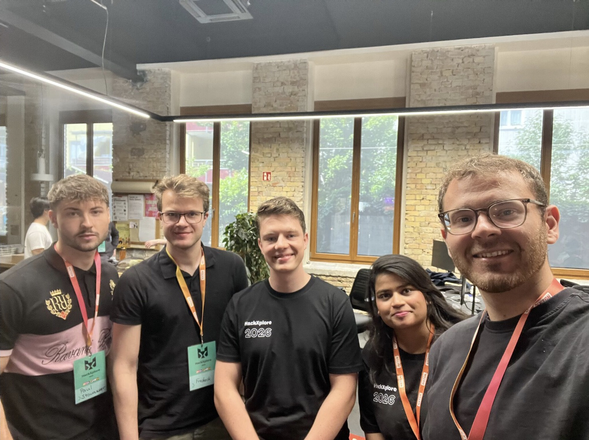
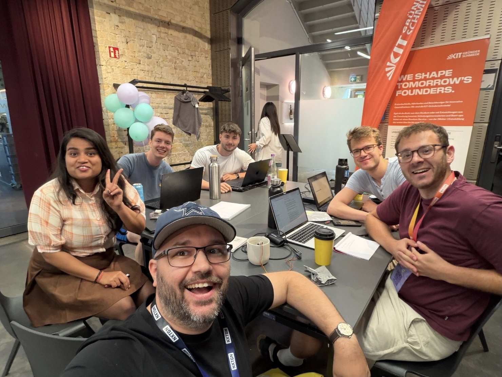

---
# Englische Fassung von index.md. Hier stehen nur die übersetzten Texte;
# Datum, Links, Reihenfolge und Entwurf kommen aus index.md.
titel: "HackXplore 2026: Smart IoT Platform for VEGA"
kurz: "Concept for an IoT platform that lets Karlsruhe water its city trees as needed. Challenge set by VEGA at the HackXplore 2026 hackathon."
tags: [IoT, MQTT, Arduino, Sensor network, Hackathon]
titelbild_alt: "Screenshot of the TreePulse dashboard with a dark theme. At the top, the weather in Karlsruhe; below it, four counters: 3 trees need water, 3 should be checked soon, 6 are healthy, 12 sensors. Below that, a map of Karlsruhe city centre with red, yellow and green dots for the sensors."
---

## The challenge

At the HackXplore 2026 hackathon, my team and I worked on a challenge set by VEGA KG: inner-city trees are to be equipped with moisture sensors to enable intelligent watering strategies in hot summers. It is meant to help the city of Karlsruhe optimise watering, be it with regard to route planning, water demand planning or the like.

A sensor kit with an Arduino and moisture sensors was available.

*Fig. 01 — Team at HackXplore 2026.*

## Our concept

The concept has three parts: a sensor network on the trees, an app for
water demand and the IoT platform.

### A sensor on every tree

Every tree has a low-cost moisture sensor. We deliberately decided against LoRa on every sensor. Instead, each sensor only communicates with its
direct neighbours on the left and right.

As in a typical star topology, the information comes together at central
stations. These stations are located at traffic lights and are connected to the
power line that is already in place there. Only there does the more complex
communication take place.

### Water as needed

Not every tree needs the same amount of water. That is why it should be
possible to simply scan in a tree's data via an app. From the tree species and
trunk diameter, the system estimates how much water the tree needs. The person
doing the watering is shown this amount as a watering time.

### The platform

The IoT platform shows the condition of every tree. It also optimises the
routes for watering.

Within the team, I took care of the MQTT backend.

*Fig. 03 — During the pitch. On the screen is the dashboard: at the top the trees that need water today, below them the map of the sensors.*

## Outlook

Tree watering is only one problem that such an IoT platform can solve. The
same platform can be used to tackle further tasks in the city, for example
detecting full litter bins.

## Pitch and teamwork

During the hackathon, my team received training on project pitching and on
communication within the team. At the end, we presented our solution to a
jury.

*Fig. 04 — At the work table during the hackathon.*

*Fig. 05 — My participation certificate: HackXplore 2026 from 26 to 28 June, challenge "Smart Watering for Urban Trees" by VEGA. [Open the certificate as PDF](/zertifikate/hackxplore-2026.pdf)*
