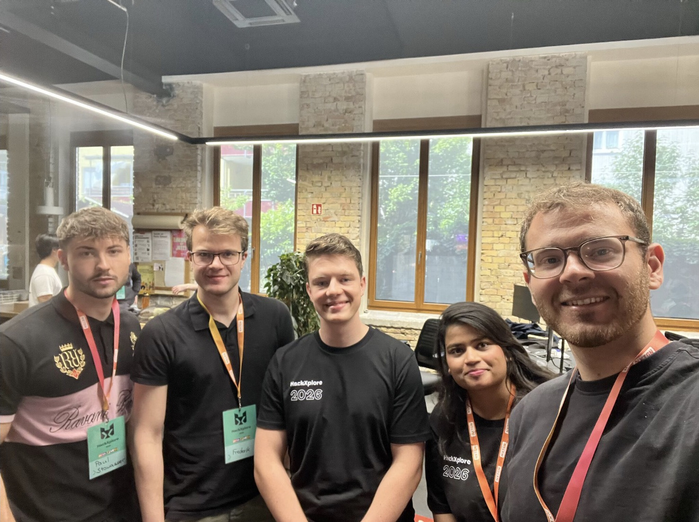
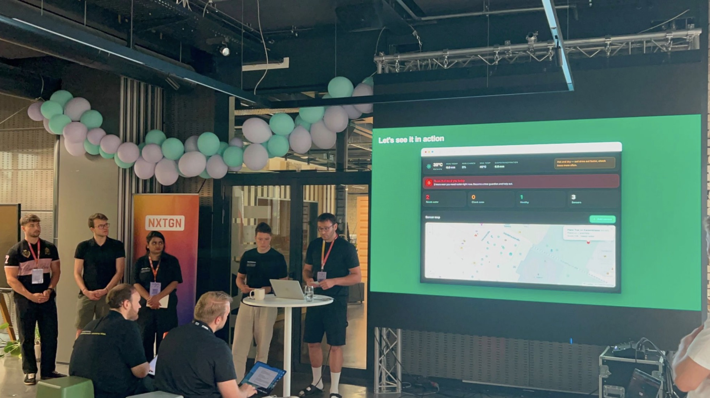
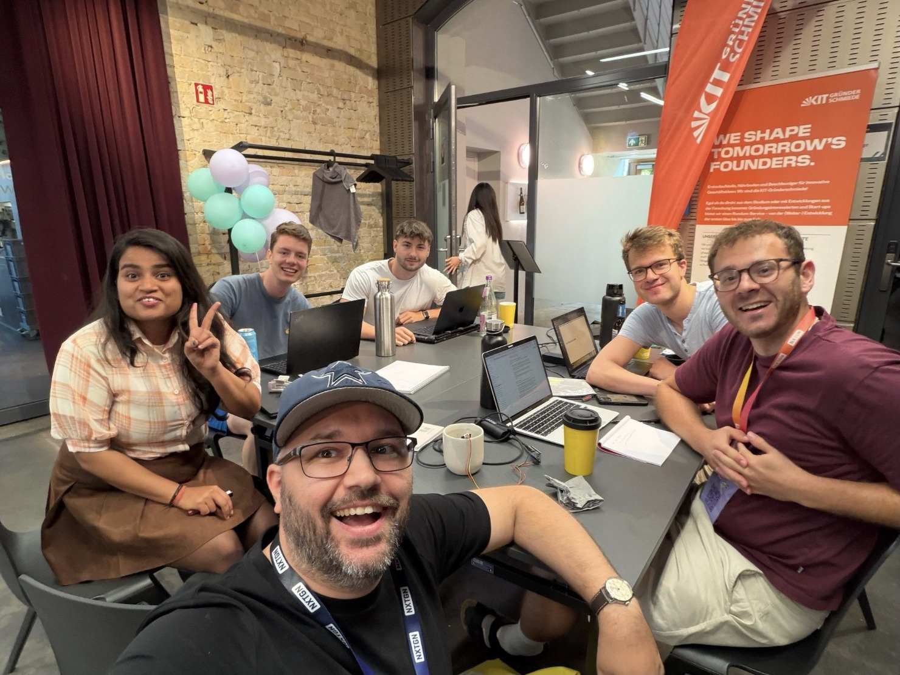
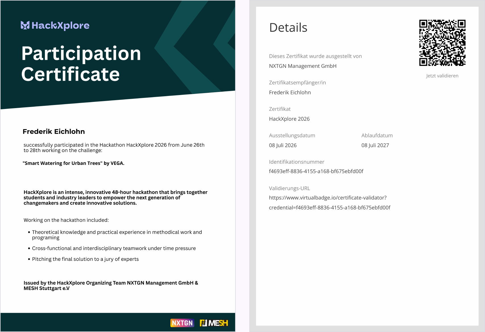

## Die Aufgabe

Beim Hackathon HackXplore 2026 habe ich mit meinem Team eine Aufgabe der VEGA KG
bearbeitet: Innerstädtische Bäume sollen mit einem Feuchtigkeitssensor ausgestattet werden, um intelligente Bewässerungsstrategien in heißen Sommern zu ermöglichen. Sie soll der Stadt Karlsruhe helfen, die Bewässerung zu optimieren, sei es in Hinsicht auf Routenplanung, Wasserbedarfsplanung o. Ä.

Zur Verfügung stand ein Sensorkit mit einem Arduino und Feuchtigkeitssensoren.

*Abb. 01 — Team beim HackXplore 2026.*

## Unser Konzept

Das Konzept hat drei Teile: ein Sensornetz an den Bäumen, eine App für den
Wasserbedarf und die IoT-Plattform.

### Ein Sensor an jedem Baum

An jedem Baum sitzt ein günstiger Feuchtigkeitssensor. Auf LoRa an jedem Sensor haben wir bewusst verzichtet. Stattdessen kommuniziert jeder Sensor nur mit seinem
direkten Nachbarn links und rechts.

Wie in einer typischen Sterntopologie laufen die Informationen an zentralen
Stationen zusammen. Diese Stationen sitzen an Ampeln und hängen an der
elektrischen Leitung, die dort schon liegt. Erst an ihnen findet die
aufwendigere Kommunikation statt.

### Wasser nach Bedarf

Nicht jeder Baum braucht dieselbe Menge Wasser. Deshalb sollen sich die Daten
eines Baums einfach per App einscannen lassen. Aus Baumart und
Stammdurchmesser schätzt das System, wie viel Wasser der Baum braucht. Der
Bewässerer bekommt diese Menge als Bewässerungszeit angezeigt.

### Die Plattform

Die IoT-Plattform zeigt den Zustand jedes Baums an. Außerdem optimiert sie die
Routen für die Bewässerung.

Im Team habe ich mich um das MQTT-Backend gekümmert.

*Abb. 03 — Beim Pitch. Auf der Leinwand das Dashboard: oben die Bäume, die heute Wasser brauchen, darunter die Karte der Sensoren.*

## Ausblick

Die Baumbewässerung ist nur ein Problem, das eine solche IoT-Plattform lösen
kann. Mit derselben Plattform lassen sich weitere Aufgaben in der Stadt
angehen, zum Beispiel volle Mülleimer erkennen.

## Pitch und Teamarbeit

Während des Hackathons hat mein Team Schulungen zum Projekt-Pitch und zur
Kommunikation im Team bekommen. Am Ende haben wir unsere Lösung einer Jury
vorgestellt.

*Abb. 04 — Am Arbeitstisch während des Hackathons.*

*Abb. 05 — Mein Teilnahmezertifikat: HackXplore 2026 vom 26. bis 28. Juni, Challenge „Smart Watering for Urban Trees“ von VEGA. [Zertifikat als PDF öffnen](/zertifikate/hackxplore-2026.pdf)*
